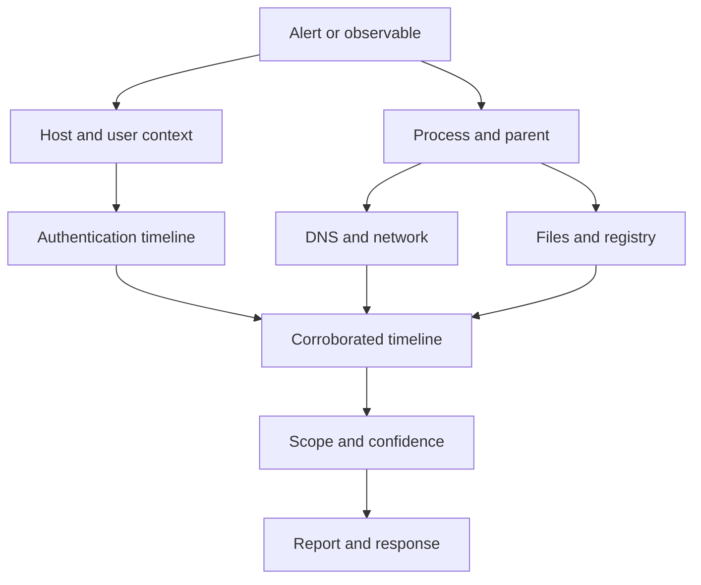

# Defensive Security Cheat Sheet

**A practical reference for defensive security investigations**  

A practical field reference for security analysts investigating suspicious activity. Covers SIEM searches, Windows and Active Directory telemetry, network analysis, malware triage, digital forensics, and incident reporting. Built around one question: **what evidence do I need next?**

Use this reference for incident triage, threat hunting, investigation practice, and documenting findings. The endpoint examples focus on Windows and Active Directory; network and analysis workflows apply more broadly. It is not an exhaustive guide to Linux, macOS, cloud, or container security.

## Coverage

| Area | Included |
|---|---|
| Investigation workflow | Evidence selection, pivots, timelines, scoping, and reporting |
| SIEM analysis | Splunk SPL, Elastic KQL, field discovery, and search troubleshooting |
| Endpoint and identity | Windows Security events, Sysmon, PowerShell, and Active Directory |
| Network analysis | Wireshark, TShark, Zeek, and beaconing hypotheses |
| Detection examples | Suricata, YARA, and Sigma |
| Malware and forensics | Static triage, JavaScript decoding, Windows artifacts, and Volatility 3 |

Use commands and investigation techniques only on systems and data you are authorized to analyze.

## How to use this reference

1. Identify the question and the relevant telemetry.
2. Verify collection coverage, time range, and field mappings.
3. Adapt an example, inspect raw records, and pivot on stable identifiers.
4. Record evidence, uncertainty, and alternative explanations.

Examples are starting points, not production-ready detections. Thresholds are illustrative. Commands and queries were reviewed against documentation where noted; they have **not been executed against a live SIEM, PCAP, or memory image**.

## Query conventions

- Replace every `<placeholder>` before running. `<PID>` is a placeholder too, not literal shell syntax.
- `<sysmon_index>` means an index **restricted to Sysmon events**; add your actual provider, source, or sourcetype filter when the index contains other logs. `<security_index>` means Windows Security events. `<index>` is dataset-specific.
- SPL examples use classic Splunk SPL. `EventCode` may instead be `EventID`, `event.code`, or another extracted field. A numeric event ID alone does not identify its provider.
- `user`, `src_ip`, `dest_ip`, and `Logon_Type` in normalized examples must be mapped to the correct fields. For 4624/4625, prefer the **target account**, not the subject account. Preserve domain/SID to avoid merging distinct identities. Validate what `host` represents in your pipeline.
- Sysmon commonly exposes `Image`, `ParentImage`, `CommandLine`, and `User`. Security 4688 uses fields such as `NewProcessName`, `ParentProcessName`, `CommandLine`, and `SubjectUserName`. Availability varies by event version and audit policy.
- `stats ... by` can drop records with missing grouping fields. Check field completeness first; do not silently merge missing identities into one detection group.
- A query fragment starting with `|` must follow a base search. Windows paths in SPL strings use escaped backslashes; YAML single-quoted strings keep literal backslashes.
- Example IPs in `192.0.2.0/24` and `203.0.113.0/24`, and `.example` domains, are documentation values.
- Record timezone and clock skew. Splunk absolute search times use the search user's timezone; UTC event XML and displayed local times may differ. An empty result can mean missing telemetry.

Example 4624/4625 normalization (inspect raw fields first):

```spl
index=<security_index> (EventCode=4624 OR EventCode=4625)
| eval user=coalesce(TargetUserName,user), src_ip=coalesce(IpAddress,Source_Network_Address,src_ip), Logon_Type=coalesce(LogonType,Logon_Type)
| table _time, host, EventCode, TargetDomainName, user, src_ip, Logon_Type
```

Use the `eval` before aggregation in the authentication templates; adapt it if the account is stored as a multivalue field. Do not append detection logic after a table that removes required fields.

Security 4688 process example:

```spl
index=<security_index> EventCode=4688
| sort 0 _time
| table _time, host, SubjectUserName, TargetUserName, NewProcessName, ParentProcessName, CommandLine, NewProcessId
```

Command-line capture for 4688 requires the relevant audit settings. Sysmon `ProcessGuid` is preferable to PID-only pivots; PIDs are reused.

## Contents

- [0. Investigation Mindset — Start Here](#section-0)
- [1. When Splunk Gives "No Results"](#section-1)
- [2. Splunk SPL Core Reference](#section-2)
- [3. Splunk Investigation Templates](#section-3)
- [4. Elastic / Kibana KQL](#section-4)
- [5. Windows Security Event IDs — High Value](#section-5)
- [6. Windows Logon Types](#section-6)
- [7. Sysmon Event IDs](#section-7)
- [8. Sysmon High-Signal Searches](#section-8)
- [9. Active Directory Attack Investigation](#section-9)
- [10. Brute Force / Password Spray](#section-10)
- [11. Network Traffic Analysis — Wireshark](#section-11)
- [12. tshark Quick Reference](#section-12)
- [13. Zeek Logs](#section-13)
- [14. Beaconing Detection](#section-14)
- [15. Suricata Rule Basics](#section-15)
- [16. YARA](#section-16)
- [17. Sigma](#section-17)
- [18. Malware Analysis](#section-18)
- [19. JavaScript Deobfuscation](#section-19)
- [20. Digital Forensics — Artifact Map](#section-20)
- [21. Volatility 3](#section-21)
- [22. MFT / USN Timeline Logic](#section-22)
- [23. Persistence Checklist](#section-23)
- [24. Common LOLBins](#section-24)
- [25. Common Attack → Evidence Map](#section-25)
- [26. "What Happened on This Host?" Template](#section-26)
- [27. "What Did This User Do?" Template](#section-27)
- [28. "What Did This IP Do?" Template](#section-28)
- [29. Timeline Building](#section-29)
- [30. Incident Scope Questions](#section-30)
- [31. Evidence Strength](#section-31)
- [32. False-Positive Discipline](#section-32)
- [33. Reporting Template](#section-33)
- [34. Investigation Troubleshooting Checklist](#section-34)
- [35. Fast Splunk Query Builder](#section-35)
- [36. Investigation Pivot Map](#section-36)
- [37. Follow the Evidence](#section-37)
- [38. Quick Reference](#section-38)

---

<a id="section-0"></a>

## 0. Investigation Mindset — Start Here

### The core loop

1. **Define the question**
   - What exactly am I trying to establish?
   - Example: "Which host initiated the suspicious PowerShell activity?"

2. **Identify the best data source**
   - Process execution → Sysmon 1 / Security 4688
   - Authentication → 4624 / 4625 / 4768 / 4769 / 4771 / 4776
   - DNS → Sysmon 22 / Zeek dns.log
   - Network → Sysmon 3 / Zeek conn.log / PCAP
   - Registry persistence → Sysmon 12–14
   - File creation → Sysmon 11 / MFT / USN Journal
   - Service creation → 7045 / 4697
   - PowerShell → 4103 / 4104
   - AD object changes → 5136; object access / replication → 4662
   - Memory → Volatility

3. **Start broad**
   - Verify the dataset.
   - Verify time range.
   - Verify field names.
   - Verify event IDs actually exist.

4. **Find an anchor**
   - IP
   - hostname
   - username
   - process
   - hash
   - domain
   - timestamp
   - ProcessGuid
   - LogonId

5. **Pivot**
   - IP → host → user → process → parent → network → file → persistence
   - User → logon → host → process → destination
   - ProcessGuid → process creation → DNS → network → file activity

6. **Build the timeline**

7. **Only conclude after multiple pieces of evidence agree.**

---

<a id="section-1"></a>

## 1. When Splunk Gives "No Results"

Before changing the hypothesis, validate the search.

### Step 1 — Is there any data?

```spl
index=*
| stats count by index
| sort - count
```

#### Goal
Find which indexes actually contain events.

---

### Step 2 — Which sourcetypes exist?

```spl
index=<index>
| stats count by sourcetype
| sort - count
```

#### Goal
Do not assume the sourcetype from another lab.

---

### Step 3 — Inspect raw events

```spl
index=<index>
| head 20
```

Then:

```spl
index=<index>
| table _time, host, source, sourcetype, _raw
```

#### Goal
Learn the actual schema before writing a complex query.

---

### Step 4 — Discover fields

```spl
index=<index>
| fieldsummary
```

or use Splunk's left-side field panel.

Common variations:

```text
src_ip
src
source_ip
SourceIp
SourceIP

dest_ip
dst
destination_ip
DestinationIp
DestinationIP

user
User
TargetUserName
Account_Name

EventCode
EventID
event.code
winlog.event_id
```

---

### Step 5 — Verify time range

For a small, isolated lab, use **All time** to locate historical data if the incident window is unknown. In production, start with a bounded window and expand deliberately; broad searches can be expensive.

```spl
index=<index>
| stats earliest(_time) as earliest latest(_time) as latest
| convert ctime(earliest) ctime(latest)
```

---

<a id="section-2"></a>

## 2. Splunk SPL Core Reference

### Broad text search

```spl
index=<index> "keyword"
```

```spl
index=<index> ("powershell" OR "cmd.exe" OR "rundll32")
```

---

### Exact field search

```spl
index=<security_index> EventCode=4624
```

```spl
index=<index> src_ip="192.0.2.10"
```

---

### Wildcards

```spl
Image="*\\powershell.exe"
```

```spl
CommandLine="*-enc*"
```

---

### Exclusion

```spl
NOT user="SYSTEM"
```

```spl
Image="*\\powershell.exe" NOT ParentImage="*\\explorer.exe"
```

---

### Table useful evidence

```spl
| table _time, host, user, Image, ParentImage, CommandLine
```

---

### Count values

```spl
| stats count by user
```

```spl
| stats count by src_ip, dest_ip
```

---

### Sort

```spl
| sort - count
```

Descending.

```spl
| sort 0 _time
```

Chronological. `sort` without a count keeps at most 10,000 results by default. `sort 0` retains all results but costs more memory; narrow the search first. [Splunk sort reference](https://help.splunk.com/en/splunk-enterprise/spl-search-reference/9.2/search-commands/sort).

---

### Top / rare

```spl
| top limit=20 Image
```

```spl
| rare limit=20 Image
```

`rare` is extremely useful for threat hunting.

---

### Deduplicate

```spl
| dedup src_ip
```

```spl
| dedup host, user
```

---

### Rename fields

```spl
| rename SourceIp as src_ip, DestinationIp as dest_ip
```

---

### Create time buckets

```spl
| bin _time span=5m
```

Example:

```spl
index=<index>
| bin _time span=5m
| stats count by _time, src_ip, dest_ip
| where count > 30
```

#### Goal
Find event bursts. Counting events alone does not establish beacon periodicity or distinguish a scan from normal traffic.

---

### Conditional counting

```spl
| stats count(eval(EventCode=4625)) as failures,
        count(eval(EventCode=4624)) as successes
        by user, src_ip
```

---

### Values vs list

```spl
| stats values(Image) by host
```

Unique values.

```spl
| stats list(Image) by host
```

Keeps repeated values in input order, up to the documented default of 100 values. Neither `list` nor `values` is a substitute for a complete event timeline.

---

### Earliest / latest

```spl
| stats earliest(_time) as first_seen latest(_time) as last_seen by src_ip
| convert ctime(first_seen) ctime(last_seen)
```

---

### Distinct count

```spl
| stats dc(dest_ip) as unique_targets by src_ip
| sort - unique_targets
```

Great for scanning.

---

### Extract text with rex

```spl
| rex field=CommandLine "(?<ip>\d{1,3}(?:\.\d{1,3}){3})"
```

---

### Regex filter

```spl
| regex CommandLine="(?i)(encodedcommand|-enc|frombase64string)"
```

---

### Search after stats

```spl
| stats count by src_ip
| search count > 20
```

or

```spl
| where count > 20
```

---

### `where` for field comparisons

```spl
| where src_ip != dest_ip
```

```spl
| where count > 30
```

---

### Transaction — use carefully

```spl
| transaction user maxspan=10m
```

Useful for small lab datasets, but often expensive. Prefer `stats` when possible.

---

<a id="section-3"></a>

## 3. Splunk Investigation Templates

### Find suspicious processes

```spl
index=<sysmon_index> EventCode=1
| table _time, host, User, ParentImage, Image, CommandLine
| sort 0 _time
```

#### Look for
- Office → cmd/PowerShell
- browser → script interpreter
- service process → unexpected shell
- `rundll32`, `regsvr32`, `mshta`, `wscript`, `cscript`
- encoded PowerShell
- executables from `%TEMP%`, `%APPDATA%`, Downloads, Public

---

### Process tree pivot

```spl
index=<sysmon_index> EventCode=1
Image="*\\suspicious.exe"
| table _time, host, User, ParentImage, ParentCommandLine, Image, CommandLine, ProcessGuid, ParentProcessGuid
```

Then pivot on:

```spl
ProcessGuid="{GUID}"
```

or:

```spl
ParentProcessGuid="{GUID}"
```

---

### Find DNS activity for a process

```spl
index=<sysmon_index> EventCode=22
Image="*\\powershell.exe"
| table _time, host, Image, ProcessId, QueryName, QueryResults
```

---

### Find connections for a process

```spl
index=<sysmon_index> EventCode=3
Image="*\\powershell.exe"
| table _time, host, Image, SourceIp, SourcePort, DestinationIp, DestinationPort
```

---

### Find activity around a timestamp

```spl
index=<index> earliest="08/07/2026:10:00:00" latest="08/07/2026:10:10:00"
host="HOST01"
| sort 0 _time
| table _time, EventCode, user, Image, CommandLine, SourceIp, DestinationIp, DestinationPort
```

Replace the timestamps with the incident window and confirm the Splunk search timezone.

---

<a id="section-4"></a>

## 4. Elastic / Kibana KQL

### Important distinction

Here, KQL means **Kibana Query Language**, not Microsoft Kusto Query Language. It filters documents; use other Elastic features for aggregation and sequencing. Exact matching depends on the field mapping: `keyword` fields differ from analyzed `text` fields.

Start with:

```text
event.code: 4624
```

---

### Exact values

```text
host.name: "DC01"
```

```text
user.name: "john"
```

---

### Wildcards

```text
process.name: powershell.exe
```

```text
process.command_line: *EncodedCommand*
```

Leading-wildcard searches can be expensive and may be disabled by `query:allowLeadingWildcards`. Inspect the mapping and setting before using this pattern. [KQL reference](https://www.elastic.co/docs/reference/query-languages/kql).

---

### Boolean logic

```text
event.code: 4624 and source.ip: 192.0.2.10
```

```text
process.name: (powershell.exe or cmd.exe)
```

```text
not user.name: SYSTEM
```

---

### Exists

```text
destination.ip: *
```

---

### Range

```text
destination.port >= 1 and destination.port <= 1024
```

---

### Common Elastic ECS fields

```text
@timestamp
host.name
user.name
source.ip
source.port
destination.ip
destination.port
process.name
process.executable
process.command_line
process.parent.name
event.code
event.category
event.action
file.name
file.path
dns.question.name
```

Datasets and ingestion pipelines may only partially follow ECS. Inspect the raw event and mapping before assuming field names.

---

<a id="section-5"></a>

## 5. Windows Security Event IDs — High Value

| Event ID | Meaning | Investigation use |
|---|---|---|
| 1102 | Security audit log cleared | Possible anti-forensics |
| 4624 | Successful logon | Authentication/lateral movement |
| 4625 | Failed logon | Brute force/password spray |
| 4634 | Logoff | Session timeline |
| 4648 | Logon attempted using explicit credentials | RunAs/lateral movement |
| 4662 | Operation performed on an object | AD access / replication with suitable auditing |
| 4672 | Special privileges assigned | Privileged logon |
| 4688 | New process created | Execution |
| 4697 | Service installed | Persistence/lateral movement |
| 4698 | Scheduled task created | Persistence |
| 4702 | Scheduled task updated | Persistence |
| 4719 | Audit policy changed | Defense evasion |
| 4720 | User account created | Persistence/account creation |
| 4722 | Account enabled | Account manipulation |
| 4724 | Password reset attempted | Account manipulation |
| 4725 | Account disabled | Account change |
| 4726 | Account deleted | Cleanup/account manipulation |
| 4728 | Member added to global security group | Privilege escalation |
| 4729 | Member removed from global group | Group changes |
| 4732 | Member added to local security group | Privilege escalation |
| 4733 | Member removed from local group | Group changes |
| 4738 | User account changed | Account manipulation |
| 4740 | Account locked out | Brute force |
| 4756 | Member added to universal security group | Privilege escalation |
| 4768 | Kerberos TGT requested | Kerberos authentication |
| 4769 | Kerberos service ticket requested | Kerberoasting/service access |
| 4771 | Kerberos pre-authentication failed | Kerberos authentication failures |
| 4776 | NTLM credential validation | NTLM authentication |
| 4798 | User's local group membership enumerated | Discovery |
| 4799 | Security-enabled local group membership enumerated | Discovery |
| 5136 | Directory object modified | AD object/GPO changes |
| 5140 | Network share accessed | SMB activity |
| 5145 | Share object access check | Requested SMB access; not proof that file contents were read |

Event **7045** is from **Service Control Manager in the System log**, not the Security log. Event IDs need provider/channel context.

### PowerShell logs

| Event ID | Channel | Meaning |
|---|---|---|
| 400 | Windows PowerShell | Engine start |
| 403 | Windows PowerShell | Engine stop |
| 4103 | PowerShell Operational | Module logging |
| 4104 | PowerShell Operational | Script block logging |

Script blocks can span multiple 4104 events. Reassemble by host, `ScriptBlockId`, and `MessageNumber` / `MessageTotal`; retain the original records. Logging depends on configuration.

#### 4104 is especially valuable
Look for:
- `IEX`
- `Invoke-Expression`
- `DownloadString`
- `WebClient`
- `FromBase64String`
- `EncodedCommand`
- `Invoke-Mimikatz`
- reflection
- AMSI bypass patterns

---

<a id="section-6"></a>

## 6. Windows Logon Types

| Logon Type | Meaning |
|---|---|
| 2 | Interactive |
| 3 | Network |
| 4 | Batch |
| 5 | Service |
| 7 | Unlock |
| 8 | NetworkCleartext |
| 9 | NewCredentials |
| 10 | RemoteInteractive / RDP |
| 11 | CachedInteractive |

Type **9** creates a local token with different outbound credentials; it does not prove those credentials authenticated remotely. Type **8** does not by itself prove a password crossed the network unencrypted. Scope `LogonId` correlation to the same host and boot/session context. [Microsoft 4624 reference](https://learn.microsoft.com/windows/security/threat-protection/auditing/event-4624).

### Useful 4624 query

```spl
index=<security_index> EventCode=4624
| stats count by Logon_Type, Account_Name, Source_Network_Address, host
| sort - count
```

Field names vary.

---

<a id="section-7"></a>

## 7. Sysmon Event IDs

Treat Sysmon events as **behavioral building blocks**, not standalone proof of maliciousness. Collection depends on the installed version and configuration; network connection and image-load telemetry may be disabled. [Microsoft Sysmon reference](https://learn.microsoft.com/sysinternals/downloads/sysmon).

| Event ID | Event | Main use |
|---|---|---|
| 1 | Process Create | Process/command-line analysis |
| 2 | File creation time changed | Timestomping |
| 3 | Network Connection | Process-to-network correlation |
| 5 | Process Terminated | Timeline |
| 6 | Driver Loaded | Kernel/rootkit activity |
| 7 | Image Loaded | DLL loading/sideloading |
| 8 | CreateRemoteThread | Process injection |
| 9 | RawAccessRead | Raw disk access |
| 10 | Process Access | Credential dumping/injection |
| 11 | File Create | Payload/dropper activity |
| 12 | Registry object create/delete | Persistence/config change |
| 13 | Registry value set | Persistence/config change |
| 14 | Registry object renamed | Registry modification |
| 15 | FileCreateStreamHash | ADS / Zone.Identifier |
| 17 | Pipe Created | IPC / malware / PsExec |
| 18 | Pipe Connected | IPC / malware / PsExec |
| 19 | WMI Filter | WMI persistence |
| 20 | WMI Consumer | WMI persistence |
| 21 | WMI Consumer-Filter binding | WMI persistence |
| 22 | DNS Query | DNS/C2 investigation |
| 23 | File Delete archived | Cleanup/ransomware |
| 25 | Process Tampering | Hollowing/herpaderping |
| 26 | File Delete detected | Cleanup |
| 27 | FileBlockExecutable | Executable creation blocked |
| 28 | FileBlockShredding | File shredding blocked |
| 29 | FileExecutableDetected | Executable creation detected |

---

<a id="section-8"></a>

## 8. Sysmon High-Signal Searches

### Suspicious parent-child relationships

```spl
index=<sysmon_index> EventCode=1
| stats count by ParentImage, Image
| sort count
```

Then inspect rare combinations.

Examples worth investigating:

```text
winword.exe -> powershell.exe
excel.exe -> cmd.exe
outlook.exe -> rundll32.exe
chrome.exe -> powershell.exe
services.exe -> cmd.exe
wmiprvse.exe -> powershell.exe
```

Not automatically malicious — investigate context.

---

### PowerShell execution

```spl
index=<sysmon_index> EventCode=1 Image="*\\powershell.exe"
| table _time, host, User, ParentImage, Image, CommandLine
```

---

### LOLBins

```spl
index=<sysmon_index> EventCode=1
(Image="*\\rundll32.exe"
 OR Image="*\\regsvr32.exe"
 OR Image="*\\mshta.exe"
 OR Image="*\\certutil.exe"
 OR Image="*\\bitsadmin.exe"
 OR Image="*\\wmic.exe"
 OR Image="*\\installutil.exe")
| table _time, host, User, ParentImage, Image, CommandLine
```

---

### LSASS access

```spl
index=<sysmon_index> EventCode=10 TargetImage="*\\lsass.exe"
| table _time, host, SourceImage, TargetImage, GrantedAccess, CallTrace
```

#### Goal
Identify processes opening LSASS.

#### Do not immediately conclude "Mimikatz"
Some legitimate security tools access LSASS.

Pivot into:
- SourceImage
- process creation
- command line
- hash
- user
- surrounding timeline

---

### Remote thread injection

```spl
index=<sysmon_index> EventCode=8
| table _time, host, SourceImage, TargetImage, StartAddress, StartModule, StartFunction
```

---

### Registry Run keys

```spl
index=<sysmon_index> (EventCode=12 OR EventCode=13 OR EventCode=14)
TargetObject="*\\CurrentVersion\\Run*"
| table _time, host, Image, EventType, TargetObject, Details
```

Also inspect:

```text
RunOnce
Winlogon
Services
Image File Execution Options
AppInit_DLLs
```

---

### File creation in user-writable paths

```spl
index=<sysmon_index> EventCode=11
(TargetFilename="*\\AppData\\*"
 OR TargetFilename="*\\Temp\\*"
 OR TargetFilename="*\\Users\\Public\\*"
 OR TargetFilename="*\\Downloads\\*")
| table _time, host, Image, TargetFilename
```

---

### DNS queries

```spl
index=<sysmon_index> EventCode=22
| stats count by QueryName
| sort count
```

Low-frequency domains can be interesting.

---

### DNS by suspicious process

```spl
index=<sysmon_index> EventCode=22 Image="*\\powershell.exe"
| table _time, host, Image, QueryName, QueryResults
```

---

<a id="section-9"></a>

## 9. Active Directory Attack Investigation

### Kerberoasting

#### Concept
An attacker requests Kerberos service tickets for accounts with SPNs, then attempts to crack the ticket offline.

#### Evidence
Main event:

```text
4769 — Kerberos service ticket requested
```

Useful fields:
- ServiceName
- TargetUserName
- IpAddress / ClientAddress
- TicketEncryptionType
- Status

#### Splunk starting point

```spl
index=<security_index> EventCode=4769
| stats count by user, ServiceName, src_ip, TicketEncryptionType
| sort - count
```

##### Hunt logic
Look for:
- one client requesting many different service tickets
- unusual service accounts
- unusual encryption types
- burst of SPN ticket requests

4769 is normal in AD. RC4 (`0x17`) can be a lead, but legitimate services may use it and roasting can target AES tickets too. Ticket requests do not prove successful offline cracking.

---

### AS-REP Roasting

#### Concept
Accounts configured without Kerberos preauthentication can have AS-REP material requested for offline cracking.

Useful event:

```text
4768 — TGT request
```

Look for successful 4768 events with `PreAuthType=0`, then verify account configuration and the requesting client. Field names and event versions vary.

```spl
index=<security_index> EventCode=4768 Status="0x0" PreAuthType=0
| table _time, host, TargetUserName, IpAddress, TicketEncryptionType, PreAuthType
```

4771 describes failed preauthentication; it is **not the primary indicator of a successful AS-REP roast**. A no-preauthentication request is a lead, not proof of cracking. [Microsoft 4768 reference](https://learn.microsoft.com/en-us/previous-versions/windows/it-pro/windows-10/security/threat-protection/auditing/event-4768).

---

### DCSync

#### Concept
An attacker abuses directory replication privileges to request password data as though they were a domain controller.

Important event:

```text
4662 — operation performed on an object
```

Look for replication-related rights, especially activity from a host/account that is **not a DC or legitimate replication account**.

##### Investigation idea

```spl
index=<security_index> EventCode=4662
| stats count by SubjectUserName, ObjectName, Properties, host
```

4662 is recorded on the DC handling the operation; its `host` is not necessarily the requesting endpoint. Correlate `SubjectLogonId` with 4624 `TargetLogonId` on that DC, within a bounded window, to recover source context. Collection requires Directory Service Access auditing and matching object SACLs.

Replication rights to inspect in `Properties`:

| Right | GUID |
|---|---|
| DS-Replication-Get-Changes | `1131f6aa-9c07-11d1-f79f-00c04fc2dcd2` |
| DS-Replication-Get-Changes-All | `1131f6ad-9c07-11d1-f79f-00c04fc2dcd2` |
| DS-Replication-Get-Changes-In-Filtered-Set | `89e95b76-444d-4c62-991a-0facbeda640c` |

Review approved DCs and synchronization identities; do not blindly exclude every account ending in `$`. [Microsoft detection example](https://github.com/Azure/Azure-Sentinel/blob/master/Solutions/Windows%20Security%20Events/Analytic%20Rules/NonDCActiveDirectoryReplication.yaml) · [Audit prerequisites](https://learn.microsoft.com/windows/security/threat-protection/auditing/audit-directory-service-access).

---

### Golden Ticket

Golden Ticket detection is correlation-heavy.

Look for:
- impossible/abnormal Kerberos session patterns
- unusual privileged account activity
- ticket behavior inconsistent with normal authentication
- account/domain SID inconsistencies when available
- logon activity without expected preceding Kerberos flow

Useful events:

```text
4624
4672
4768
4769
```

Never rely on a single event. A missing 4768 can also reflect ticket reuse, retention gaps, or an uncollected DC; absence alone does not prove a forged ticket.

---

### NTLM / Relay Investigation

Useful telemetry:

```text
4776 — NTLM credential validation
4624 — successful logon
5140/5145 — SMB share access
Zeek SMB logs / PCAP
```

Pivot:
- source IP
- destination
- account
- timing
- repeated network logons

---

### PsExec-style lateral movement

Common clues:

```text
SMB connection to target
ADMIN$ / IPC$
service creation
named pipes
remote service execution
```

Useful events:

```text
4624 Logon Type 3
5140/5145
4697
7045
Sysmon 17/18
Sysmon 1
```

Potential service/name examples may vary. Do not rely only on service name.

---

### RDP

Useful evidence:

```text
4624 Logon Type 10
4778 reconnect
4779 disconnect
```

Starting search:

```spl
index=<security_index> EventCode=4624 Logon_Type=10
| table _time, host, Account_Name, Source_Network_Address
```

---

<a id="section-10"></a>

## 10. Brute Force / Password Spray

The following queries assume normalized source/account fields. Thresholds are examples, not universal baselines. Fixed buckets split activity at boundaries; inspect adjacent buckets and longer periods. Also review 4771/4776 or identity-provider logs where failures occur away from the endpoint.

### Brute force against one user

```spl
index=<security_index> EventCode=4625
| bin _time span=5m
| stats count by _time, src_ip, user
| where count > 20
```

---

### Password spray

One source → many users → relatively few attempts per user. The query below finds broad targeting; inspect per-user counts before calling it a spray. Distributed or slow attacks can evade these thresholds.

```spl
index=<security_index> EventCode=4625
| bin _time span=10m
| stats count as attempts dc(user) as unique_users values(user) as users by _time, src_ip
| where unique_users > 10
| sort - unique_users
```

---

### Success after failures

Count earlier failures in a rolling ten-minute window for the same source, account, and destination host. These fields must be normalized first (see Query conventions).

```spl
index=<security_index> (EventCode=4624 OR EventCode=4625)
| where isnotnull(src_ip) AND isnotnull(user) AND isnotnull(host)
| sort 0 _time
| streamstats time_window=10m current=f
    count(eval(EventCode=4625)) as preceding_failures
    max(eval(if(EventCode=4625,_time,null()))) as last_failure
    by host, src_ip, user
| where EventCode=4624 AND preceding_failures > 5 AND _time > last_failure
| table _time, host, src_ip, user, preceding_failures, last_failure, Logon_Type
```

This identifies a success preceded by more than five failures, not necessarily consecutive failures or a compromised password. Equal-timestamp events need another ordering key. Check failure reasons, logon type, NAT, stale credentials, and subsequent activity. `streamstats` has configured event/memory limits; use bounded searches and validate against known events. [Command reference](https://help.splunk.com/en/splunk-enterprise/spl-search-reference/9.3/search-commands/streamstats).

---

<a id="section-11"></a>

## 11. Network Traffic Analysis — Wireshark

### Display filters

#### IP

```text
ip.addr == 192.0.2.10
```

```text
ip.src == 192.0.2.10
```

```text
ip.dst == 192.0.2.10
```

---

#### TCP / UDP

```text
tcp
```

```text
udp
```

```text
tcp.port == 443
```

```text
udp.port == 53
```

---

#### DNS

```text
dns
```

```text
dns.qry.name contains "example"
```

```text
dns.flags.response == 0
```

Queries only.

```text
dns.flags.response == 1
```

Responses.

---

#### HTTP

```text
http
```

```text
http.request
```

```text
http.request.method == "POST"
```

```text
http.host contains "example"
```

```text
http.request.uri contains "login"
```

---

#### TLS

```text
tls
```

```text
tls.handshake.type == 1
```

Client Hello.

Encrypted traffic limits visibility: HTTP fields generally require plaintext or decryption. SNI may be concealed by ECH, and TLS 1.3 encrypts certificate messages after ServerHello. A fingerprint is a lead, not an identity.

Useful for:
- SNI
- JA3/JA4 if dataset/tools expose them
- certificate analysis
- beacon timing

---

#### SMB

```text
smb2
```

```text
smb2.cmd == 5
```

SMB2 command 5 is CREATE (opening or creating an object); it does not necessarily mean a new file was written.

---

#### Kerberos

```text
kerberos
```

Common filters:

```text
kerberos.msg_type == 10
```

AS-REQ

```text
kerberos.msg_type == 12
```

TGS-REQ

---

#### ICMP

```text
icmp
```

---

#### TCP SYN scans

```text
tcp.flags.syn == 1 && tcp.flags.ack == 0
```

Look for one source sending SYNs to many ports/hosts.

---

#### TCP resets

```text
tcp.flags.reset == 1
```

---

#### Suspicious large DNS

```text
dns && frame.len > 200
```

`frame.len` is the whole captured frame length, not DNS payload size. DNSSEC and ordinary responses can be large. Inspect label lengths, query volume, record types, response codes, and timing before inferring tunneling.

---

<a id="section-12"></a>

## 12. tshark Quick Reference

### Read PCAP

```bash
tshark -r capture.pcap
```

---

### Filter

```bash
tshark -r capture.pcap -Y 'ip.addr == 192.0.2.10'
```

---

### DNS names

```bash
tshark -r capture.pcap -Y 'dns.flags.response == 0' \
  -T fields -e ip.src -e dns.qry.name
```

---

### HTTP requests

```bash
tshark -r capture.pcap -Y 'http.request' \
  -T fields -e ip.src -e ip.dst -e http.request.method -e http.host -e http.request.uri
```

---

### TCP conversations

```bash
tshark -r capture.pcap -q -z conv,tcp
```

---

### IP conversations

```bash
tshark -r capture.pcap -q -z conv,ip
```

---

### Endpoints

```bash
tshark -r capture.pcap -q -z endpoints,ip
```

These are excellent first commands for understanding a PCAP.

---

<a id="section-13"></a>

## 13. Zeek Logs

Important logs:

| Log | Use |
|---|---|
| conn.log | Network connections |
| dns.log | DNS |
| http.log | HTTP |
| ssl.log / x509.log | TLS/certificates |
| files.log | Files observed |
| smb_files.log | SMB files |
| smb_mapping.log | SMB shares |
| kerberos.log | Kerberos |
| ntlm.log | NTLM |
| ssh.log | SSH |
| notice.log | Zeek detections |
| weird.log | Protocol anomalies |

### `conn.log` fields to know

```text
ts
uid
id.orig_h
id.orig_p
id.resp_h
id.resp_p
proto
service
duration
orig_bytes
resp_bytes
conn_state
```

#### Mental translation

```text
id.orig_h = connection originator IP (usually the client)
id.resp_h = connection responder IP (usually the server)
```

---

`zeek-cut` expects Zeek TSV logs with headers. For JSON logs, use `jq`. Correlate related logs using `uid`; a `uid` is a connection identifier, not a host identity. Missing logs may reflect analyzer configuration or visibility.

### Useful command-line inspection

```bash
zeek-cut id.orig_h id.resp_h id.resp_p < conn.log | sort | uniq -c | sort -nr
```

---

### DNS

```bash
zeek-cut id.orig_h query answers < dns.log
```

---

### HTTP

```bash
zeek-cut id.orig_h id.resp_h host uri user_agent < http.log
```

---

<a id="section-14"></a>

## 14. Beaconing Detection

C2 beaconing can create approximately periodic connections. Use one record per connection from a single source (for example Zeek conn.log), not mixed DNS, process, and packet events. Narrow by protocol and destination port to avoid merging unrelated services.

### Splunk idea

```spl
index=<index>
| sort 0 _time
| streamstats current=f last(_time) as prev_time by src_ip, dest_ip
| eval delta=_time-prev_time
| where delta > 0
| stats count as intervals avg(delta) as mean_s stdev(delta) as sd_s min(delta) as min_s max(delta) as max_s by src_ip, dest_ip
| where intervals > 10 AND mean_s > 0
| eval coefficient_of_variation=sd_s/mean_s
| sort coefficient_of_variation
```

#### Interpretation
Low standard deviation and coefficient of variation can suggest regular intervals. Jitter, sleep, proxies, duplicate logs, and missing telemetry affect this heuristic. It does not prove C2.

But:
- monitoring agents beacon
- software updates beacon
- cloud clients beacon

Validate destination, process, DNS, volume, and host context.

---

<a id="section-15"></a>

## 15. Suricata Rule Basics

Generic structure:

```text
alert <protocol> <source> <src_port> -> <destination> <dst_port> (
    msg:"Description";
    content:"pattern";
    sid:1000001;
    rev:1;
)
```

Example **Suricata** rule for an outbound HTTP request (save as one line):

```text
alert http $HOME_NET any -> $EXTERNAL_NET any (msg:"LAB PowerShell HTTP User-Agent"; flow:established,to_server; http.user_agent; content:"PowerShell"; nocase; sid:1000001; rev:1;)
```

This matches a User-Agent string, including legitimate traffic. It does not inspect encrypted HTTPS without suitable visibility. Confirm `$HOME_NET`, `$EXTERNAL_NET`, and an unused local SID. Snort syntax differs by version; do not treat this as a portable Snort rule.

Validate configuration and rule loading before replaying a known test PCAP:

```bash
suricata -T -c /path/to/suricata.yaml -S local.rules
```

[Suricata HTTP keyword reference](https://docs.suricata.io/en/latest/rules/http-keywords.html).

### Key keywords

```text
msg
content
nocase
flow
distance
within
offset
depth
pcre
sid
rev
classtype
reference
threshold
```

---

<a id="section-16"></a>

## 16. YARA

### Basic rule

```yara
rule Suspicious_Example
{
    meta:
        author = "Analyst"
        description = "Example defensive detection"

    strings:
        $a = "powershell" ascii nocase
        $b = "FromBase64String" ascii
        $c = { 4D 5A }

    condition:
        $c at 0 and 1 of ($a,$b)
}
```

This illustrative rule is intentionally broad: an MZ header and a PowerShell string do not establish maliciousness. Validate against benign and malicious samples before deployment.

### Useful modifiers

```text
ascii
wide
nocase
fullword
xor
base64
```

### Conditions

```yara
any of them
all of them
2 of them
1 of ($network*)
filesize < 1MB
uint16(0) == 0x5A4D
```

---

### CLI

```bash
yara rule.yar suspicious.exe
```

Recursive:

```bash
yara -r rules.yar /path/
```

Show matching strings:

```bash
yara -s rules.yar suspicious.exe
```

---

<a id="section-17"></a>

## 17. Sigma

### Basic rule shape

```yaml
title: PowerShell Encoded Command Candidate
id: 7d8e5ab4-3c29-4f06-9a42-0c6f3b819d25
description: Broad educational example requiring environment-specific tuning.
status: experimental
logsource:
  category: process_creation
  product: windows

detection:
  selection:
    Image|endswith: '\powershell.exe'
    CommandLine|contains:
      - '-enc'
      - 'EncodedCommand'

  condition: selection

falsepositives:
  - Administrative scripts and software deployment
level: low
```

The `-enc` substring also matches longer benign switches such as `-Encoding`. This is a hunt example, not a production detection. Include PowerShell Core (`pwsh.exe`) when relevant. Sigma needs a backend and field-mapping pipeline to become a runnable SIEM query.

### Common modifiers

```text
contains
startswith
endswith
re
all
windash
base64
base64offset
```

### Think in layers

A good Sigma rule answers:

```text
What log source?
What behavior?
What fields?
What false positives?
What combination creates confidence?
```

Do not make rules too IOC-specific unless the IOC itself is the intended detection.

---

<a id="section-18"></a>

## 18. Malware Analysis

### First 5 minutes

Use static analysis first. Perform dynamic analysis only in an isolated, disposable environment. Do not upload confidential samples or evidence to public scanning services without authorization. Hash the original and analyze a working copy; use SHA-256 for integrity, with MD5 only as a legacy lookup value.

#### Hash

Linux:

```bash
sha256sum sample.exe
md5sum sample.exe
```

Windows:

```powershell
Get-FileHash .\sample.exe -Algorithm SHA256
```

---

#### File type

```bash
file sample.exe
```

---

#### Strings

```bash
strings sample.exe
```

Unicode:

```bash
strings -el sample.exe
```

Interesting grep:

```bash
strings sample.exe | grep -Ei 'http|https|powershell|cmd\.exe|user-agent|\.dll|\.exe'
```

---

#### FLOSS

```bash
floss sample.exe
```

Useful for decoded/stack strings.

---

#### capa

```bash
capa sample.exe
```

Useful for identifying likely capabilities:
- networking
- persistence
- credential access
- process injection
- file operations

Treat results as leads, not final proof.

---

#### PE indicators

Check:
- compile timestamp
- imports
- exports
- sections
- entropy
- digital signature
- resources
- suspicious strings
- packer indicators

Interesting APIs:

```text
VirtualAlloc
VirtualProtect
WriteProcessMemory
CreateRemoteThread
OpenProcess
WinExec
ShellExecute
CreateProcess
InternetOpen
InternetConnect
URLDownloadToFile
RegSetValue
CreateService
```

Context matters.

---

<a id="section-19"></a>

## 19. JavaScript Deobfuscation

### First steps

1. Beautify the JavaScript.
2. Rename meaningless variables.
3. Identify:
   - `eval`
   - `Function`
   - `atob`
   - `unescape`
   - `decodeURIComponent`
   - `String.fromCharCode`
   - long arrays
   - XOR loops
4. Decode layers one at a time.
5. Do not execute unknown code directly.

### Base64

Browser/Node concept:

```javascript
atob("...")
```

Linux:

```bash
echo 'BASE64' | base64 -d
```

---

### URL decoding

Python:

```python
from urllib.parse import unquote
print(unquote("%68%74%74%70"))
```

---

### Hex

Python:

```python
bytes.fromhex("68747470").decode()
```

---

<a id="section-20"></a>

## 20. Digital Forensics — Artifact Map

| Artifact | What it can answer |
|---|---|
| MFT | File creation/modification metadata |
| USN Journal | File system change history |
| Prefetch | Program execution evidence |
| Amcache | Application inventory and file metadata; presence alone does not prove execution |
| ShimCache | Application compatibility / file-presence evidence; execution interpretation is OS-dependent |
| BAM/DAM | Application execution |
| SRUM | Application/network usage |
| Registry | Persistence, users, devices, configuration |
| Event Logs | Authentication, execution, services, PowerShell |
| LNK files | User-opened files/paths |
| Jump Lists | User application/file history |
| Zone.Identifier | Mark-of-the-Web and possible origin URLs; may be absent, removed, or copied |
| Browser history | Web activity/downloads |
| Memory | Processes, sockets, injected code, credentials/artifacts |

---

Artifact availability varies by OS and configuration. Timestamps can be altered, and Prefetch, BAM, or SRUM coverage is incomplete. Correlate artifacts before attributing execution to a specific user.

<a id="section-21"></a>

## 21. Volatility 3

Record the Volatility version and image hash. Symbol availability and image/OS support affect results; a plugin error is not a negative finding.

General syntax:

```bash
python3 vol.py -f memory.raw windows.info
```

### Processes

```bash
python3 vol.py -f memory.raw windows.pslist
```

```bash
python3 vol.py -f memory.raw windows.pstree
```

```bash
python3 vol.py -f memory.raw windows.psscan
```

#### Why three?
- `pslist` → active process linked list
- `pstree` → parent/child context
- `psscan` → scans memory and can find terminated/unlinked processes

---

### Command lines

```bash
python3 vol.py -f memory.raw windows.cmdline
```

---

### Network

```bash
python3 vol.py -f memory.raw windows.netscan
```

---

### DLLs

```bash
python3 vol.py -f memory.raw windows.dlllist --pid <PID>
```

---

### Handles

```bash
python3 vol.py -f memory.raw windows.handles --pid <PID>
```

---

### Malfind

```bash
python3 vol.py -f memory.raw windows.malware.malfind
```

Recent versions use `windows.malware.malfind`; older builds may expose `windows.malfind`. Use `python3 vol.py -h` to inspect your installation. Findings may include legitimate JIT memory and absence of findings does not exclude injection. [Plugin reference](https://volatility3.readthedocs.io/en/stable/volatility3.plugins.windows.malware.malfind.html).

---

### Dump process-related content

Plugin options vary by Volatility version. Always check:

```bash
python3 vol.py <plugin> -h
```

---

<a id="section-22"></a>

## 22. MFT / USN Timeline Logic

When you find a suspicious executable:

1. When did it first appear?
2. Which file activity occurred immediately before it?
3. Which process executed it?
4. Was it renamed?
5. Was it deleted?
6. What other files appeared in the same directory?
7. Is there evidence of download origin?
8. Does the timestamp align with event logs/network traffic?

Think in **clusters**, not isolated artifacts.

---

<a id="section-23"></a>

## 23. Persistence Checklist

When compromise is confirmed, check:

```text
Run / RunOnce registry keys
Services
Scheduled tasks
Startup folders
WMI subscriptions
DLL search-order hijacking
Winlogon keys
Office add-ins
Browser extensions
New users
Group membership changes
Remote access tools
SSH authorized_keys
Web shells
GPO modifications
```

---

<a id="section-24"></a>

## 24. Common LOLBins

Know these names:

```text
powershell.exe
pwsh.exe
cmd.exe
rundll32.exe
regsvr32.exe
mshta.exe
certutil.exe
bitsadmin.exe
wmic.exe
wscript.exe
cscript.exe
installutil.exe
reg.exe
schtasks.exe
sc.exe
net.exe
net1.exe
nltest.exe
whoami.exe
wevtutil.exe
curl.exe
```

Their presence is not inherently malicious.

Ask:

```text
Who launched it?
From where?
With what arguments?
What happened immediately before?
What network activity followed?
What file/registry changes followed?
```

---

<a id="section-25"></a>

## 25. Common Attack → Evidence Map

| Technique | First places to look |
|---|---|
| PowerShell execution | Sysmon 1, 4104, 4688 |
| Credential dumping | Sysmon 10 → LSASS, process creation |
| Brute force | 4625, 4740 |
| Password spray | 4625 across many users |
| Successful compromise after spray | 4625 → 4624 |
| Kerberoasting | 4769 |
| AS-REP roasting | 4768 / Kerberos context |
| DCSync | 4662 + replication context |
| Account creation | 4720 |
| Group privilege escalation | 4728 / 4732 / 4756 |
| Service persistence | 4697 / 7045 |
| Scheduled task | 4698 / 4702 |
| RDP | 4624 Type 10, 4778, 4779 |
| SMB lateral movement | 4624 Type 3, 5140, 5145 |
| DNS C2 | Sysmon 22, Zeek DNS |
| Process C2 | Sysmon 3 + Sysmon 1 |
| Process injection | Sysmon 8 / 10 / 25 |
| Registry persistence | Sysmon 12–14 |
| WMI persistence | Sysmon 19–21 |
| Payload dropped | Sysmon 11, MFT, USN |
| Log clearing | 1102 |
| PowerShell obfuscation | 4104 + process command line |
| Network scan | many destinations/ports from one source |
| Beaconing | repeated periodic network activity |

---

<a id="section-26"></a>

## 26. "What Happened on This Host?" Template

Start broad:

```spl
index=<index> host="<HOST>"
| stats count by EventCode
| sort - count
```

Then processes:

```spl
index=<sysmon_index> host="<HOST>" EventCode=1
| sort 0 _time
| table _time, User, ParentImage, Image, CommandLine
```

Then network:

```spl
index=<sysmon_index> host="<HOST>" EventCode=3
| table _time, Image, SourceIp, DestinationIp, DestinationPort
```

Then DNS:

```spl
index=<sysmon_index> host="<HOST>" EventCode=22
| table _time, Image, QueryName, QueryResults
```

Then files:

```spl
index=<sysmon_index> host="<HOST>" EventCode=11
| table _time, Image, TargetFilename
```

Then registry:

```spl
index=<sysmon_index> host="<HOST>" (EventCode=12 OR EventCode=13 OR EventCode=14)
| table _time, Image, EventType, TargetObject, Details
```

#### Why this sequence?
It reconstructs:

```text
execution → communication → artifact creation → persistence
```

---

<a id="section-27"></a>

## 27. "What Did This User Do?" Template

```spl
index=<index> user="<USER>"
| stats count by host, EventCode
| sort - count
```

Authentication:

```spl
index=<security_index> user="<USER>" (EventCode=4624 OR EventCode=4625)
| sort 0 _time
| table _time, host, EventCode, Logon_Type, src_ip
```

Processes:

```spl
index=<sysmon_index> User="<USER>" EventCode=1
| sort 0 _time
| table _time, host, ParentImage, Image, CommandLine
```

---

<a id="section-28"></a>

## 28. "What Did This IP Do?" Template

```spl
index=<index> "192.0.2.10"
| stats count by sourcetype, EventCode
| sort - count
```

Then normalize the relevant field names and inspect:

```spl
index=<index> (src_ip="192.0.2.10" OR dest_ip="192.0.2.10")
| sort 0 _time
| table _time, host, user, src_ip, src_port, dest_ip, dest_port, Image
```

#### Important
Do not assume the IP is the attacker.

Determine whether it is:
- client
- server
- victim
- proxy
- DNS resolver
- NAT gateway
- domain controller

---

<a id="section-29"></a>

## 29. Timeline Building

A useful incident timeline:

All rows below are synthetic. Record full date, UTC offset, source, and event/record ID in a real timeline. A Run key change supports *possible* persistence; determine what value was written.

| Time | Host | User | Evidence | Interpretation |
|---|---|---|---|---|
| 10:01 | WS01 | bob | 4624 Type 3 from 192.0.2.10 | Network logon |
| 10:02 | WS01 | bob | PowerShell process | Execution |
| 10:02 | WS01 | bob | DNS query evil.example | Infrastructure lookup |
| 10:03 | WS01 | bob | Connection to 203.0.113.10:443 | External communication |
| 10:04 | WS01 | bob | Run key modified | Possible persistence |

This is far stronger than saying:

> "PowerShell was malicious."

---

<a id="section-30"></a>

## 30. Incident Scope Questions

Before calling the investigation complete, answer:

```text
What was the initial access vector?
Which user was first compromised?
Which host was first compromised?
What process executed first?
What payload was delivered?
What persistence was established?
What credentials were accessed?
Was privilege escalation performed?
Was lateral movement performed?
Which systems were touched?
Which accounts were touched?
What C2 infrastructure was used?
Was data staged or exfiltrated?
Was anything deleted or altered?
What is the earliest malicious timestamp?
What is the latest confirmed malicious timestamp?
```

---

<a id="section-31"></a>

## 31. Evidence Strength

### Weak evidence
- uncommon process
- unusual IP
- rare domain
- suspicious filename

### Medium evidence
- suspicious command line
- Office spawning PowerShell
- process connecting to suspicious domain
- unexpected service installation

### Stronger evidence
Multiple independent sources agree:

```text
process creation
+
script block content
+
DNS resolution
+
network connection
+
payload file creation
+
persistence
```

Always prefer correlation.

---

<a id="section-32"></a>

## 32. False-Positive Discipline

Before declaring malicious:

1. Is the behavior expected for this host?
2. Is the user an administrator?
3. Is this a management/security tool?
4. Is the destination internal infrastructure?
5. Is this software deployment?
6. Is there a legitimate parent-child relationship?
7. Does the timing line up with other suspicious behavior?
8. Is there corroborating telemetry?

---

<a id="section-33"></a>

## 33. Reporting Template

### Executive Summary

```text
On <date/time>, security telemetry identified <initial event>.
Investigation confirmed that <threat actor/activity> affected <systems/users>.
The activity included <major actions>.
The observed impact was <confirmed impact>; <remaining impact> is not established.
```

---

### Incident Details

#### Initial Detection
What alerted you?

#### Initial Access
How did the attacker enter?

#### Execution
What ran?

#### Persistence
How did they remain?

#### Privilege Escalation
Did privileges change?

#### Credential Access
Were credentials targeted?

#### Discovery
What did they enumerate?

#### Lateral Movement
Where did they move?

#### Command and Control
Which domains/IPs/protocols?

#### Exfiltration
Was data transferred?

#### Defense Evasion
Were logs/configurations altered?

---

Record evidence identifiers, collection method, SHA-256 where applicable, timezone, confidence, affected assets, and explicit unknowns. Separate observations from conclusions.

### Indicators of Compromise

| Type | Value | Context |
|---|---|---|
| IP | x.x.x.x | C2 |
| Domain | example.com | DNS/C2 |
| SHA256 | ... | Malware |
| File | bad.exe | Payload |
| User | user1 | Compromised account |

---

### Remediation

Split into:

#### Immediate containment
Preserve volatile evidence when feasible; balance collection against the need to stop active harm. Record response actions and obtain operational authorization.

- isolate affected hosts
- disable/reset compromised accounts
- block confirmed malicious infrastructure
- terminate confirmed malicious processes when appropriate

#### Eradication
- remove persistence
- delete malicious artifacts
- patch exploited vulnerability
- revoke tokens/credentials

#### Recovery
- restore/rebuild systems
- re-enable accounts safely
- monitor for recurrence

#### Long-term prevention
- detection improvements
- logging improvements
- hardening
- MFA
- least privilege
- segmentation
- vulnerability remediation

---

<a id="section-34"></a>

## 34. Investigation Troubleshooting Checklist

When stuck:

```text
[ ] Time window and timezone verified?
[ ] Correct index?
[ ] Correct sourcetype?
[ ] Correct EventCode/EventID field?
[ ] Correct capitalization?
[ ] Field actually exists?
[ ] IP is stored in another field?
[ ] Username includes DOMAIN\user?
[ ] Hostname includes domain suffix?
[ ] Raw event contains the value?
[ ] Search too restrictive?
[ ] Can I remove filters one at a time?
[ ] Can I pivot using another IOC?
[ ] Is there another log source?
[ ] Am I assuming the answer instead of proving it?
```

---

<a id="section-35"></a>

## 35. Fast Splunk Query Builder

Use this mental structure:

```spl
index=<where>
sourcetype=<what-log>
<Event selector>
<anchor>
| <aggregation>
| <filter>
| <display>
```

Example (replace index/sourcetype with values discovered in your data):

```spl
index=<sysmon_index> EventCode=22
QueryResults="*192.0.2.25*"
| stats values(QueryName) as domains by host
```

`QueryResults` can contain several answers; this substring search is a discovery step. Parse addresses for exact matching, since a substring can also match a longer value.

Break it down:

```text
index            → where are the events?
EventCode=22     → DNS events
QueryResults     → anchor/pivot
stats values     → remove duplicates and organize evidence
host             → preserve victim context
```

---

<a id="section-36"></a>

## 36. Investigation Pivot Map



---

<a id="section-37"></a>

## 37. Follow the Evidence

Do not search directly for the answer you expect.

Instead:

```text
Question:
Did host A perform suspicious DNS activity?

Evidence needed:
DNS telemetry from host A.

Search:
Show DNS queries for host A.

Observation:
Host A queried domain X.

Next question:
Which process made the query?

Pivot:
Sysmon 22 ProcessGuid / Image.

Next question:
Did that process communicate externally?

Pivot:
Sysmon 3 / Zeek conn.log.

Next question:
How was the process started?

Pivot:
Sysmon 1 parent-child process chain.
```

That is how a defensive investigation grows from **evidence**, rather than from guessing.

---

<a id="section-38"></a>

## 38. Quick Reference

### Splunk discovery

```spl
index=* | stats count by index
```

```spl
index=<index> | stats count by sourcetype
```

```spl
index=<index> | head 20
```

```spl
index=<index> | fieldsummary
```

---

### Windows essentials

```text
4624 success
4625 failure
4648 explicit credentials
4672 privileged logon
4688 process
4697 service
4698 scheduled task
4720 user created
4728/4732/4756 group membership
4768 TGT
4769 service ticket
4771 Kerberos pre-auth failure
4776 NTLM
5136 AD object modified
5140/5145 SMB
4104 PowerShell script block
7045 service installation
```

---

### Sysmon essentials

```text
1  process
3  network
7  image/DLL
8  remote thread
10 process access
11 file creation
12-14 registry
17-18 pipes
19-21 WMI
22 DNS
25 process tampering
```

---

### PCAP

```text
ip.addr == x.x.x.x
tcp
udp
dns
http
tls
smb2
kerberos
tcp.flags.syn == 1 && tcp.flags.ack == 0
```

---

### Core questions

```text
WHO?
WHAT?
WHEN?
WHERE?
HOW?
WHAT NEXT?
HOW FAR DID IT SPREAD?
WHAT PROVES IT?
```

---


## References

Consult the documentation matching your installed versions. Links below support tool syntax and interpretation; this is not a claim that every example has been integration-tested.

- [Microsoft Sysmon](https://learn.microsoft.com/sysinternals/downloads/sysmon)
- [Windows Security auditing events](https://learn.microsoft.com/windows/security/threat-protection/auditing/advanced-security-auditing-faq)
- [Splunk Search Reference](https://help.splunk.com/en/splunk-enterprise/spl-search-reference/9.2/search-commands/sort)
- [Elastic KQL](https://www.elastic.co/docs/reference/query-languages/kql)
- [Wireshark display filter reference](https://www.wireshark.org/docs/dfref/)
- [TShark manual](https://www.wireshark.org/docs/man-pages/tshark.html)
- [Zeek logs](https://docs.zeek.org/en/current/logs/index.html)
- [Suricata rules](https://docs.suricata.io/en/latest/rules/index.html)
- [YARA rules](https://yara.readthedocs.io/en/stable/writingrules.html)
- [Sigma specification](https://github.com/SigmaHQ/sigma-specification)
- [Volatility 3](https://volatility3.readthedocs.io/en/stable/)
- [Mandiant capa](https://github.com/mandiant/capa) and [FLOSS](https://github.com/mandiant/flare-floss)

